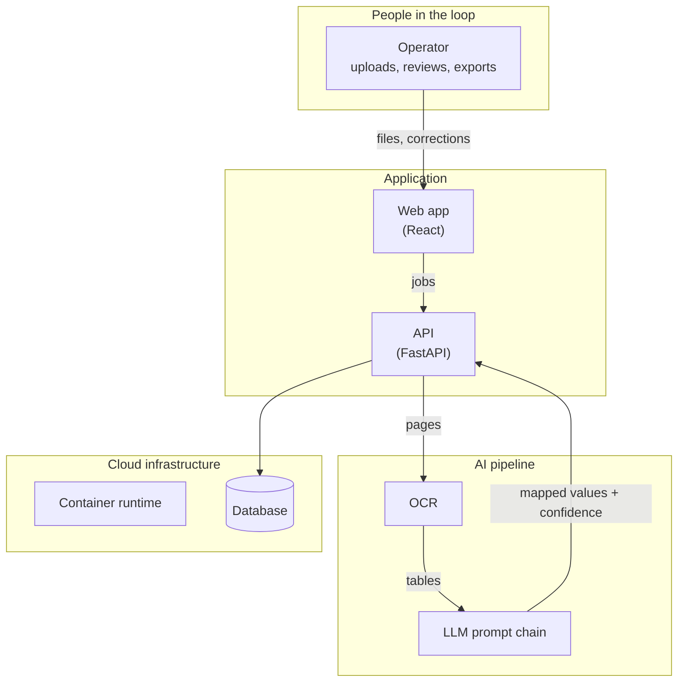

<!--
Headings below are placeholders describing each section's job.
Replace every heading with a claim specific to this project, ideally an
"X, not Y" contrast, as in "A statement is a set of tables, not a document".
Prose sections: 40 to 150 words. Detail lives in diagrams and lists.
-->

## <Hook: the problem as a contrast>
<2 short paragraphs. What the customer's people did by hand, what it cost them, and the one idea that reframes the problem. No technology yet.>

## <Constraints: what made it hard>
<One lead-in line, then 4 to 6 bullets, each with a bold label.>
- **<Messy input>.** <one sentence>
- **<No training data / legacy system / compliance / deadline>.** <one sentence>

## <Scoping: what we built first, and what we didn't>
<40 to 100 words. The raw ambiguous request, who on the customer side I worked with (by role), what shipped first and why, what was explicitly left out.>

## <Architecture: one principle that shaped it>
<One or two sentences stating the principle, e.g. "The model proposes, the operator decides".>

*<One-line caption: what to notice in the diagram.>*

## <Flow: the core loop as a sequence of states>
<One lead-in line, then the numbered states. Use the real job or document states from the code when they exist.>
1. **<State>.** <what happens>. *Moves when:* <trigger>.
2. **<State>.** <what happens>. *Moves when:* <trigger>.

<Optional: "Every other way out": failure states, in a short list.>

## <A decision and its trade-off>
<60 to 120 words. One design choice, the alternative that was considered or rejected, and why. Prompting vs fine-tuning, human review vs full automation, one model call vs a chain.>

## <What changed when the plan met the customer>
<60 to 120 words. One or two moments where scope or design changed, what triggered it and what I did.>

## What I owned
<Respect role phases: hands-on work and lead work are both ownership. 4 to 6 areas.>
### <Area, e.g. Prompt chain design>
<1 to 2 sentences.>
### <Area, e.g. Infrastructure and CI/CD>
<1 to 2 sentences.>

## <How we knew it worked>
<Only for AI projects. 60 to 120 words. How quality was measured at the time (eval set, metric, operator corrections, or honestly: spot checks) and one failure mode found and fixed.>

## <Outcome>
<60 to 120 words. Adoption (who, how many, how often, how long), impact (the number) and time to production. The same numbers appear in the frontmatter metrics.>

## Retro
<2 to 3 sentences, required. What broke and what I underestimated. Specific, not a moral.>

## If I rebuilt it today
<Optional, 2 to 4 sentences, written clearly as a redesign ("Today I would..."). What I'd scope differently and, for AI projects, the eval layer I'd add: what I'd measure, on what data, how it would gate changes. If a public companion project shows it, link it in one line.>
